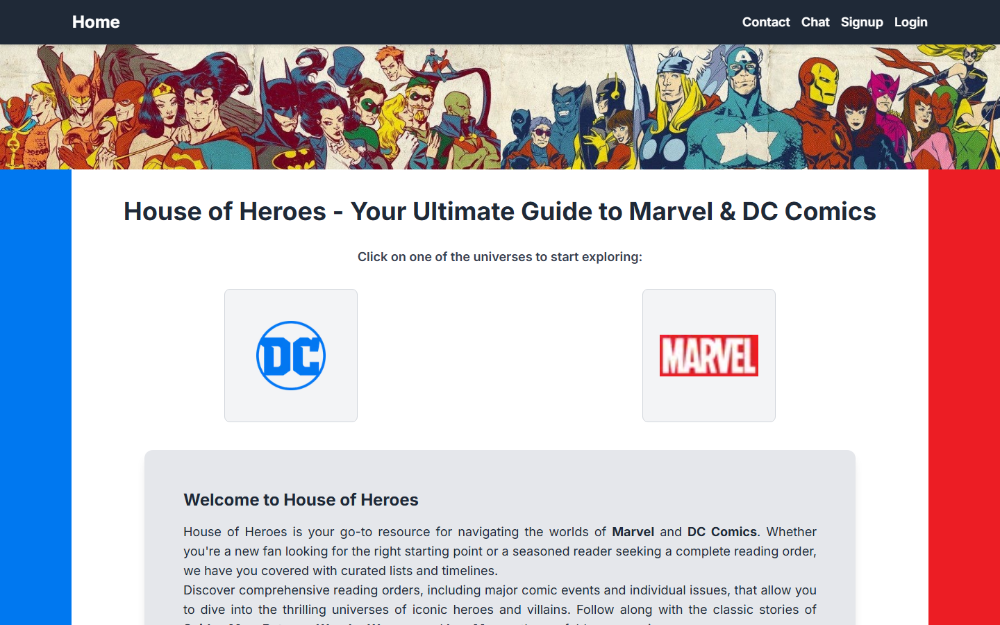
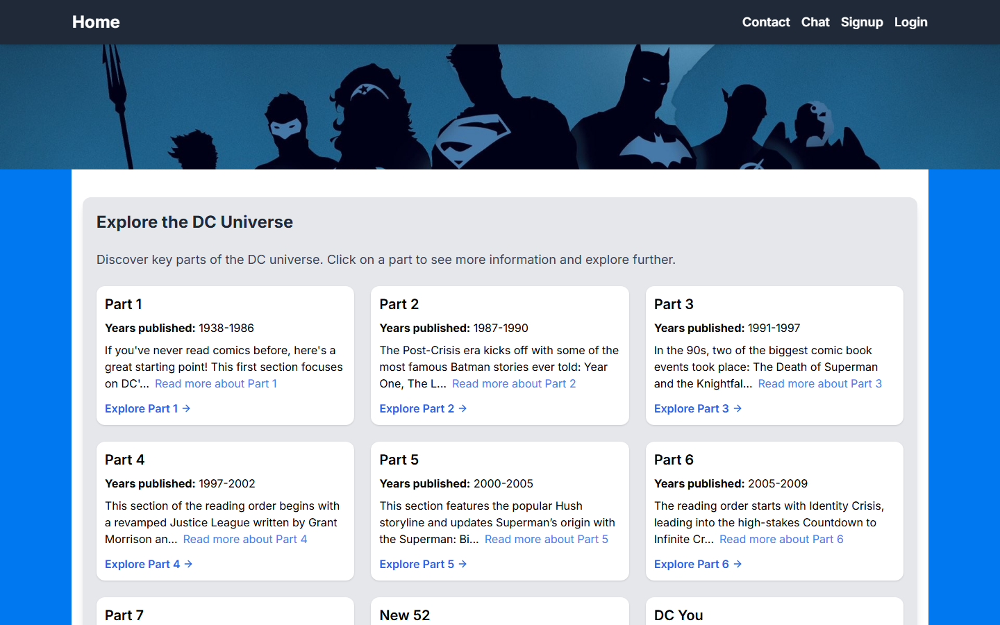
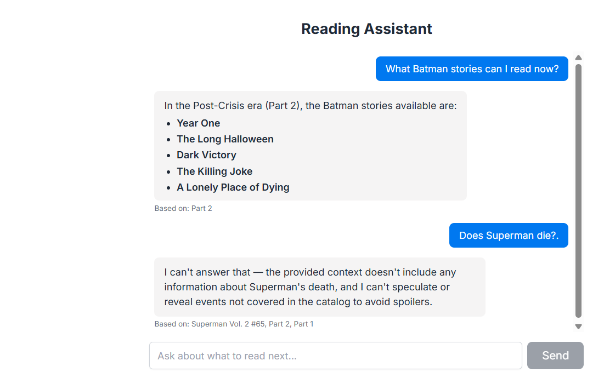

# House of Heroes — Web

Frontend for **[houseofheroes.dev](https://houseofheroes.dev)**, a reading-order guide for DC and Marvel comics. Browse each universe's timeline (sagas → events → issues), save events and issues to your collection, mark what you've read, and ask an AI reading assistant that **never spoils anything past your reading position**.

**Backend / API:** [back-HouseOfHeroes](https://github.com/Betoquintero/back-HouseOfHeroes) (Node.js, MongoDB Atlas Vector Search, Claude) · [API docs](https://157-90-114-16.sslip.io/api-docs)

`Next.js 14 (App Router)` `React 18` `TypeScript` `Tailwind CSS` `Jest` `React Testing Library` `Playwright` `Vercel`

| Home | DC timeline |
|---|---|
|  |  |

**AI reading assistant:** this reader has reached the early '90s, so it recommends what's available and refuses to spoil Superman's fate.



## Features

- **Timeline browsing** for DC and Marvel: sagas, events and issues, with summaries and reading context.
- **Accounts:** sign up with email verification, login, password reset, profile editing.
- **Collections and reading progress:** save events and issues, toggle issues as read.
- **AI reading assistant** (`/chat`): answers stream in token by token and show the catalogue sources they were based on. The backend filters out anything past your reading position.
- **Admin-only categorisation tool** (`/categorize`): the LLM suggests where a new comic fits in the timeline.

## How it works

### Rendering
Catalogue pages (`/parts`, `/events`, `/issues`) are **Server Components** that fetch from the API on the server, so content is in the HTML for SEO and first paint. Interactive pieces (auth forms, chat, collections, profile editing) are Client Components. SEO extras: site metadata and Open Graph tags, a generated `sitemap.xml` (`next-sitemap`) and `robots.txt`.

### Authentication
- The API issues a **15-minute access token** and a **refresh token in an httpOnly cookie** (sent with `credentials: 'include'`).
- Every authenticated request goes through a single helper, **`authenticatedFetch`** (`app/context/AuthContext.tsx`). It attaches the token and, on a `401`, refreshes once silently and retries. The mount-time session check uses the same path, so reloading a tab with an expired access token keeps you logged in.
- Logout revokes the refresh token on the server, not just in local state.
- `middleware.ts` redirects anonymous users away from protected routes. Admin-only UI is shown based on the user's role, while the API enforces it independently.

### Streaming chat
The chat endpoint is a `POST` with an `Authorization` header, which `EventSource` can't do. So the client reads the **Server-Sent Events stream manually** from `fetch` with `response.body.getReader()` (`parseChatStream` in `lib/api.ts`): it appends each `delta` event to the message as it arrives, then attaches the `sources` from the final `done` event. Errors such as `401` or `429` arrive as normal JSON before the stream starts and are handled separately.

## Quality

- **Unit and component tests:** Jest + React Testing Library, **22 suites / 182 tests**, covering the auth context (refresh and retry, logout, role lookup), the SSE parser, pages and components.
- **E2E:** Playwright specs for sign-up and the critical flow (log in → save an event → mark an issue as read), run against the real stack.
- **CI (GitHub Actions):** `tsc --noEmit` → ESLint → Jest → production build, on every push and PR. E2E stays out of CI on purpose, because it needs the real backend, MongoDB Atlas and the AI providers.
- **Strict TypeScript:** no `any` in production code, ESLint with `next/typescript`.

### Bugs the tests and live testing caught
- **Logged out on reload:** the mount-time `/auth/me` check had its own fetch logic without refresh, so reloading with an expired access token logged the user out. Fixed by routing every authenticated call through one shared refresh-and-retry helper.
- **Spurious logout:** a successful request made *without* a token was treated as "refresh failed" because of an overloaded `token ?? null` return. Fixed with an explicit `refreshFailed` flag.
- **Sources never shown:** a flag was set inside a React state updater, which React may run later, so code right after the stream ended still read the stale value. Fixed by setting it synchronously outside the updater.

## Running locally

Requirements: Node 24, npm, and the [API](https://github.com/Betoquintero/back-HouseOfHeroes) running locally or a deployed API URL.

```bash
cp .env.example .env   # NEXT_PUBLIC_API_URL=http://localhost:8000/api/v1
npm install
npm run dev            # http://localhost:4000
```

| Script | What it does |
|---|---|
| `npm run dev` / `npm run build` / `npm start` | Develop, build, serve (port 4000) |
| `npm test` | Jest unit and component tests |
| `npm run e2e` | Playwright E2E (needs the API running) |
| `npm run lint` | ESLint |

## Project structure

```
app/                  App Router pages (catalogue, auth, profile, chat, categorize, legal)
app/components/       UI components (timeline grids, details, chat window, profile, forms)
app/context/          AuthContext: session, authenticatedFetch, role
app/__test__/         Jest + React Testing Library tests
lib/api.ts            API client: catalogue fetchers, refresh/logout, SSE parser
middleware.ts         Route protection
e2e/                  Playwright specs
```

## What I'd do next

- **Incremental Static Regeneration for the catalogue.** It rarely changes, but pages are currently fetched with `no-store` on every request. Pages could be cached and revalidated on demand when an admin edits the catalogue.
- **Fix the profile page after a hard reload with an expired access token.** The page is a Server Component, so it fetches before the client gets a chance to refresh. It needs a Route Handler that refreshes and forwards the new cookie.
- **Keep the access token in memory instead of a JS-readable cookie**, to reduce the impact of a potential XSS.
